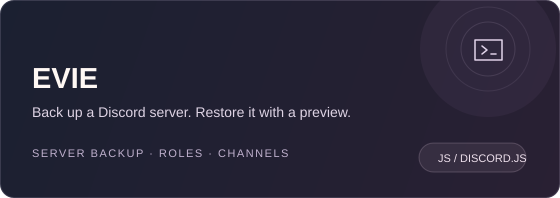
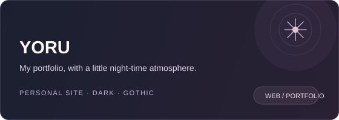
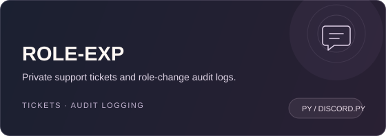
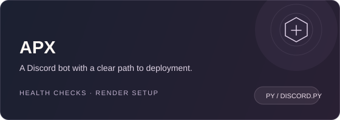
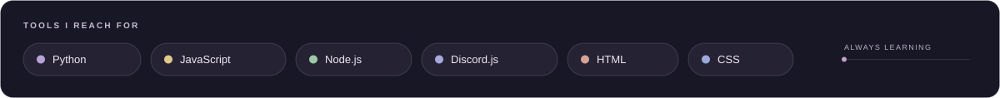

  

  <a href="https://ayush7hx.github.io/yoru/">PORTFOLIO</a>
  &nbsp;&nbsp;·&nbsp;&nbsp;
  <a href="https://discord.gg/ajhxf2qUd">DARK INFINITE</a>
  &nbsp;&nbsp;·&nbsp;&nbsp;
  <a href="https://www.instagram.com/ayush7hx/">INSTAGRAM</a>
  &nbsp;&nbsp;·&nbsp;&nbsp;
  <a href="https://www.snapchat.com/@ayush7hx">SNAPCHAT</a>
  &nbsp;&nbsp;·&nbsp;&nbsp;
  <a href="mailto:ayusharyaft63@gmail.com">SAY HELLO</a>

 

## A few things I've built

  
  
  
  

  More experiments: <a href="https://github.com/ayush7hx/INFINITE">INFINITE</a> · <a href="https://github.com/ayush7hx/INF-AUTONICK">INF-AUTONICK</a> · <a href="https://github.com/ayush7hx/7hx">7hx</a> · <a href="https://github.com/ayush7hx?tab=repositories">all repositories</a>

 

  

 

  Made with curiosity, too many late-night ideas, and a lot of learning along the way.

