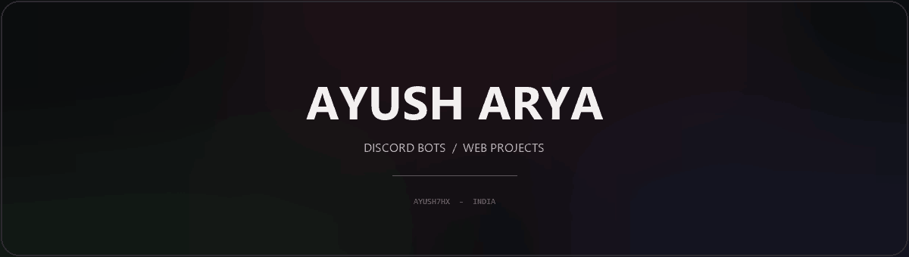
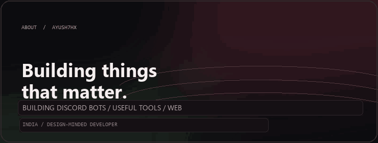
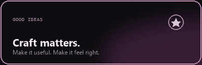
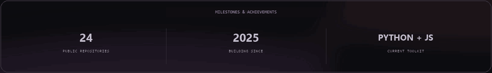
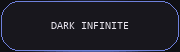
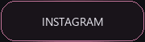

  

<table>
  <tr>
    <td width="64%">
      
    </td>
    <td width="36%">
      
       
      
    </td>
  </tr>
</table>

  

 

  <h2>MILESTONES &amp; ACHIEVEMENTS</h2>
  
  Verified profile milestones, not invented GitHub awards. GitHub shows earned platform achievements automatically.

 

  
  
  
  
  
  

 

  INDIA &nbsp;|&nbsp; BUILDING WITH CURIOSITY &nbsp;|&nbsp; OPEN TO GOOD IDEAS

 

  <h2>SELECTED WORK</h2>
  A few things I've been building

<table>
  <tr>
    <td width="50%">
      <h3><a href="https://github.com/ayush7hx/EVIE">EVIE</a></h3>
      
Discord server structure backups and carefully previewed restores.

      JavaScript | Discord.js
    </td>
    <td width="50%">
      <h3><a href="https://ayush7hx.github.io/yoru/">YORU</a></h3>
      
A dark, gothic-inspired personal portfolio and web experience.

      Web | Visual design
    </td>
  </tr>
  <tr>
    <td width="50%">
      <h3><a href="https://github.com/ayush7hx/TitanBot">TITANBOT</a></h3>
      
A multipurpose Discord assistant built for server communities.

      Discord | Automation
    </td>
    <td width="50%">
      <h3><a href="https://github.com/ayush7hx/Meekly-Discord-Bot">MEEKLY</a></h3>
      
A Discord security and moderation bot project.

      Python | Discord
    </td>
  </tr>
</table>

  <h2>COMMUNITY</h2>
  
<a href="https://discord.gg/ajhxf2qUd"><strong>DARK INFINITE</strong> | Join the Discord community</a>

  Dark Infinite is my Discord community. No public GitHub organization memberships are connected to this account yet.

  <h2>ABOUT</h2>

I'm Ayush Arya — a developer from India. I build Discord bots, practical tools, and web projects, with a soft spot for thoughtful interfaces and dark visual design.

- **Currently exploring:** Discord automation, web experiences, and better project UX
- **Languages & tools:** Python, JavaScript, Node.js, HTML, and CSS
- **Portfolio:** [ayush7hx.github.io/yoru](https://ayush7hx.github.io/yoru/)
- **More about me:** [guns.lol/ayush7hx](https://guns.lol/ayush7hx)

  GOOD IDEAS DESERVE GOOD CRAFT.

